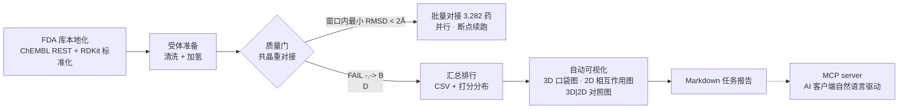
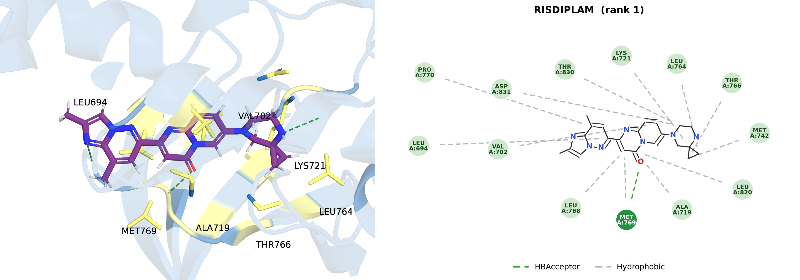
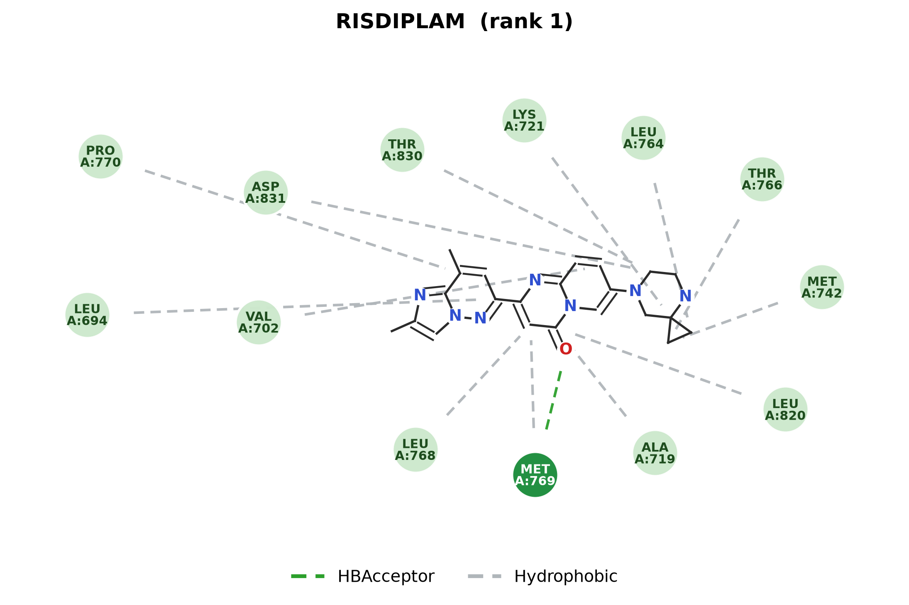

# AutoVS

**AutoVS** 是一套面向药物重定位的 **FDA 已上市药物库批量虚拟筛选框架**：从 FDA 库本地化、受体准备、redocking 质量门，到 AutoDock Vina 批量对接、出版级 3D/2D 可视化与 Markdown 任务报告，全流程一条命令完成，并可通过 **MCP server** 交给任意 AI 客户端（Trae / Claude / Cursor）自主驱动。



> **零基础？请从[图文教程](docs/tutorial.md)开始**——30 分钟从裸机到出第一份报告，每个输出都有逐元素解读。

## 效果预览（真实筛选产物）

每张对照图左边 3D 口袋、右边 2D 相互作用，残基一一对应。下图为 demo 靶点（EGFR 激酶域 × 共晶配体 AQ4，PDB 1M17）20 化合物冒烟筛选的 Top1 命中（RISDIPLAM）：



2D 相互作用图细节（深绿=氢键残基、浅绿=疏水、粉紫=π 堆积、红=盐桥，虚线连到配体具体参与原子）：



完整任务报告示例：[output_figure/EGFR_demo/smoke/report.md](output_figure/EGFR_demo/smoke/report.md)。

## 功能特性

- **FDA 库全量本地化**：EBI ChEMBL REST（`max_phase=4` 已上市小分子）一键抓取 → RDKit 标准化（去盐、pH 7.4 质子化、ETKDG+MMFF94 3D 构象）→ 本地索引；**运行期 100% 离线**
- **Redocking 质量门**：全库筛选前强制共晶配体重对接，判据为"打分窗口（1.0 kcal/mol）内最小 RMSD < 2 Å"（规避 Vina 打分近简并排序歧义），**FAIL 即拒绝全库筛选**
- **批量对接**：多进程并行 + `result.json` 落盘，天然断点续跑；配置指纹校验防串味
- **离群大分子自动防护**：MW/可旋转键超限条目提交前预过滤（防 Vina 天级卡死与接触面积虚高假阳性）+ 单配体超时兜底，失败一律隔离不阻塞批次
- **出版级可视化（全自动化）**
  - 3D：PyMOL 正交投影口袋特写——半透明 cartoon、口袋残基 stick、像素级探针标定的残基标签（引导线数学上不交叉、永不压配体）
  - 2D：Discovery Studio 风格相互作用图——配体键线式居中、残基椭圆环绕节点按相互作用类型着色
  - `*_pair.png` 横拼对照图：3D 与 2D 残基一一对应，同图互读
- **任务报告**：Markdown 自包含报告（概览/质量门/统计/Top 排行/图谱对照/解读注意事项），内附全量 rank 排行 CSV 副本，与图谱同目录、相对链接、整包可拷走
- **MCP server**：10 个工具暴露全流程，AI 客户端自然语言驱动（长任务提交/查询模式，server 重启不丢任务）

## 环境配置

| 依赖 | 说明 |
|---|---|
| Python ≥ 3.11 | RDKit、numpy、matplotlib、PIL、pdbfixer、OpenMM |
| AutoDock Vina ≥ 1.2 | 对接引擎 |
| Meeko（mk_prepare_receptor / mk_prepare_ligand） | PDB→PDBQT、SDF→PDBQT |
| Open Babel | 格式转换（可选） |
| PyMOL ≥ 2.5 | 3D 渲染（可选；缺失时自动跳过 3D 只出 2D） |

### 方式 A：conda 一键安装（推荐，外部工具一并装好）

```bash
# 1) 从 environment.yml 创建环境（conda-forge + bioconda 源，
#    含 vina / meeko / openbabel / fpocket / rdkit / dimorphite-dl）
conda env create -f environment.yml          # 或 mamba/micromamba create -n autovs -f environment.yml
conda activate autovs

# 2) 安装 AutoVS 本体（dev=pytest；mcp=仅 AI 客户端驱动时需要）
pip install -e ".[dev,mcp]"
```

> 说明：`environment.yml` 中的 GROMACS/Ambertools 为可选注释项，仅命中分子后续 MD 验证需要，批量虚拟筛选无需安装。

### 方式 B：pip 裸环境（外部工具自备）

```bash
# 1) 纯 Python 环境
python3.11 -m venv .venv
source .venv/bin/activate
pip install -e ".[dev,mcp]"

# 2) 外部工具（vina / meeko / obabel / fpocket / pymol）自行安装，
#    并将绝对路径写入 config/framework.yaml 的 tools: 段
```

安装完成后体检（校验外部工具路径、库索引、目录布局是否就绪）：

```bash
autovs doctor
```

所有外部工具路径在 `config/framework.yaml` 的 `tools:` 段配置（绝对路径），修改后跑 `autovs doctor` 校验。

## 快速开始

```bash
# 0)（可选）重建 FDA 库：联网抓取 ChEMBL 已上市小分子并标准化（本仓库已内置索引与 prepared 库，可跳过）
autovs library fetch && autovs library build     # library 子命令：fetch/build/stats/verify-offline

# 1) 新靶点：复制模板并填写
cp config/targets/template.yaml config/targets/my_target.yaml
#    最少必填：name / pdb_id / chains / reference_ligand.resname
#    box.mode=reference_ligand 时盒子由共晶配体质心自动计算

# 2) 受体准备 + 质量门（建议显式先跑，确认 PASS）
autovs receptor --target config/targets/my_target.yaml
autovs gate     --target config/targets/my_target.yaml

# 3) 全库筛选（先小批量冒烟验证链路，再全量）
autovs dock --target config/targets/my_target.yaml --tag screen --limit 50
autovs dock --target config/targets/my_target.yaml --tag screen          # 全量 3,282；中断后重跑即续算

# 4) 可视化 + 报告（dock 完成会自动执行；也可单独跑）
autovs visualize --target config/targets/my_target.yaml --tag screen --top 10
autovs visualize --target ... --tag screen --entry "tadalafil,IMATINIB"  # 指定化合物（名称子串/entry_id，逗号分隔）
autovs report     --target config/targets/my_target.yaml --tag screen --top 20
```

## 配置体系（三层）

配置分层加载：`framework.yaml`（路径/工具/运行时）+ `library.yaml`（数据源与库构建）+ `targets/*.yaml`（每个靶点一份，独立可复用）。`autovs doctor` 会汇总校验。

### 1. `config/framework.yaml` —— 框架级

| 字段 | 说明 |
|---|---|
| `framework.seed` | 全局随机种子（构象生成 / Vina seed） |
| `paths.root / library_dir / temp_dir / output_data_dir / output_figure_dir` | 目录布局，约定绝对路径 |
| `tools.python / vina / mk_prepare_receptor / mk_prepare_ligand / mk_export / obabel / fpocket / pymol` | 外部工具绝对路径；`pymol` 可选 |
| `runtime.workers` | 并行 worker 数（每 worker 一个 vina 进程） |
| `runtime.vina_threads` | 单 vina 进程线程数（多进程并行时保持 1） |
| `runtime.log_level / request_timeout / request_retries` | 日志级别；联网下载超时与重试 |

### 2. `config/library.yaml` —— FDA 库本地化

| 字段 | 说明 |
|---|---|
| `source.type` | 数据源：`chembl`（默认，REST 抓取 max_phase=4）/ `zinc`（直链，站点反爬时勿用）/ `local`（导入本地 SDF/SMI） |
| `source.base_url / max_phase / molecule_type / page_size` | ChEMBL 抓取参数 |
| `prepare.ph / ph_tolerance` | 生理 pH 7.4 ± 1.0 质子化 |
| `prepare.fragment_parent` | 去盐（保留最大有机片段） |
| `prepare.embed / optimize` | 3D 构象 ETKDG + MMFF94 优化 |
| `prepare.shard_size / skip_existing` | prepared/ 分片大小；断点续跑开关 |
| `local.*` | raw 记录、manifest、prepared 目录与索引 CSV 路径 |

**数据流**：`source.fetch（仅此步联网）→ raw/ → build（纯本地）→ prepared/ + index/`。本仓库已附带构建好的索引（`data/fda_library/index/fda_library_index.csv`，3,282 个可对接化合物）；`prepared/` 3D 结构体积较大不入库，可由 `autovs library build` 从索引重建。详见 [fda_library_localization.md](docs/fda_library_localization.md)。

### 3. `config/targets/<靶点>.yaml` —— 靶点

| 字段 | 说明 |
|---|---|
| `target.name` | 靶点名（决定输出目录名） |
| `target.pdb_id / structure_path` | PDB 编号（自动下载缓存）或本地结构路径 |
| `target.chains` | 参与对接的链 |
| `target.reference_ligand.resname / chain` | 共晶配体三字母码与链（用于口袋定义、质量门、负参照） |
| `target.box.mode` | `reference_ligand`（共晶配体质心 + padding 自动盒子，推荐）或手动 `center/size` |
| `target.box.padding / min_box / max_box` | 自动盒子外扩与尺寸钳制 |
| `gate.rmsd_threshold / score_window` | 质量门判据：打分窗口内最小 RMSD 阈值（默认 2.0 Å / 1.0 kcal/mol） |
| `gate.exhaustiveness / num_modes` | 重对接精度（质量门建议 32） |
| `docking.exhaustiveness / num_modes` | 全库对接精度（默认 8 / 9，速度与精度平衡） |
| `docking.score_threshold` | 命中阈值（默认 -7.0 kcal/mol） |
| `docking.top_n` | 汇总后自动可视化的 Top N |
| `docking.redock_seed` | 对接随机种子（保证可复现） |
| `docking.max_rotatable_bonds` | 离群预过滤：可旋转键上限（默认 30；0=关闭），超限条目提交前跳过 |
| `docking.max_mol_weight` | 离群预过滤：分子量上限 Da（默认 1000；0=关闭） |
| `docking.ligand_timeout_s` | 单配体 Vina 超时秒数（默认 1800；0=不限制），超时杀进程并按失败隔离 |

新增靶点只需：清洗好的 PDB（或给 PDB ID 自动下载）+ 共晶配体名，复制 `template.yaml` 改三行即可。

## 命令行参考

```
autovs doctor                         环境与工具体检
autovs library fetch                  联网抓取 FDA 库原始记录（ChEMBL/ZINC/local 三源可插拔）
autovs library build                  标准化 + 3D 构象 + 本地索引（纯本地）
autovs library stats                  库规模统计
autovs library verify-offline         离线可用性自检
autovs receptor --target <yaml>       受体清洗（去配体/水/altloc 归一）+ 加氢
autovs gate     --target <yaml>       质量门：共晶重对接 RMSD 校验
autovs dock     --target <yaml> --tag <标签> [--limit N]
                                      批量对接（断点续跑；完成后自动汇总排行 + 可视化 + 报告）
autovs visualize --target <yaml> --tag <标签> [--top N | --entry "名称,IDA..."]
                                      3D+2D+对照图；--entry 指定化合物（忽略 --top）
autovs report    --target <yaml> --tag <标签> [--top N]
                                      生成 Markdown 任务报告
autovs mcp                            启动 MCP server（stdio）
```

通用参数 `--framework / --library / --log-level` 可覆盖默认配置与日志（默认 `config/framework.yaml`、`config/library.yaml`）。排行榜与打分分布由 dock 自动汇总生成；对接完成后重跑 `autovs dock` 只会补算缺失化合物，不重复消耗。

## MCP 配置

**前置依赖**（与上面筛选运行环境分离，仅 AI 客户端驱动需要）：

```bash
pip install "mcp>=1.30,<2"      # 或安装本体时带上：pip install -e ".[mcp]"
```

将以下配置加入 AI 客户端（Trae / Claude Desktop / Cursor）的 MCP 设置即可用自然语言驱动全流程：

```json
{
  "mcpServers": {
    "autovs": {
      "command": "<你的 python>",
      "args": ["-m", "autovs.mcp_server"],
      "cwd": "<AutoVS 绝对路径>"
    }
  }
}
```

> **详细配置步骤（各客户端配置文件位置）、10 个工具逐个详解、实战话术示例与排错表，见 [MCP 指南](docs/mcp_guide.md)。**

| 工具 | 功能 |
|---|---|
| `doctor` / `library_stats` / `library_search` | 环境体检 / 库统计 / 搜库 |
| `prepare_receptor` / `run_gate` | 受体准备 / 质量门 |
| `submit_dock` / `dock_status` | 后台提交对接（返回 job_id）/ 查询真实进度（数 result.json，server 重启可追查） |
| `query_ranking` | 排行榜查询（Top N / 阈值过滤） |
| `visualize` / `generate_report` | 图谱生成（支持 entries 指定化合物）/ 任务报告 |

## 输出布局

```
output_data/<靶点>/
  <批次>_ranking.csv                  全量排行榜（rank/打分/MW/logP/命中阈值…）
  <批次>_summary.json                 汇总统计
output_figure/<靶点>/
  <批次>_score_distribution.pdf       全库打分分布
  <批次>/                             任务自包含目录（整包可拷走）
    report.md                         Markdown 任务报告
    <批次>_ranking.csv                全量排行榜副本（rank 排序，与 report 同包）
    MANIFEST.csv                      图谱索引（rank/化合物/打分/路径/相互作用清单）
    pose_R{rank}_{药名}_3d.png        3D 口袋特写
    pose_R{rank}_{药名}_2d.{pdf,png}  2D 相互作用图
    pose_R{rank}_{药名}_pair.png      3D|2D 横拼对照（文件名即对应关系）
    top_overview.png                  Top N 叠加总览
temp/                                 中间产物（受体/对接工作目录，可随时删除重算）
```

## 方法论要点（解读结果前必读）

- **质量门先行**：共晶配体重对接必须在打分窗口内复现晶体姿势（最小 RMSD < 2 Å）才允许全库筛选；注意判据是"窗口内最小"而非 top-1 pose——Vina 打分存在近简并排序歧义，晶体姿势可能在 mode 4/5。
- **打分语义**：Vina 打分为半经验打分函数，用于**富集排序**，绝对值不等于结合自由能；Top 命中建议经 MD/MMPBSA 或实验复核。
- **已知偏差**：Vina 对大环、多芳环、高柔性分子存在系统性打分偏好；Top 命中中该类骨架占比偏高时，建议按分子量/柔性分箱后再比较。
- **2D 相互作用为几何判据推断**：氢键 H···A ≤ 2.6 Å 且 D-H···A > 110°；疏水 C···C ≤ 4.0 Å；盐桥 ≤ 4.0 Å；π 堆积环心距 ≤ 5.5 Å；阳离子-π ≤ 5.0 Å。供快速检视，不构成定量结论。
- **可复现性**：全局 seed + 每靶点 redock_seed + 配置指纹校验（配置变更后自动拒绝复用旧中间产物）。

## 数据与许可

- FDA 已上市药物数据源自 [EBI ChEMBL](https://www.ebi.ac.uk/chembl/)（CC BY-SA 3.0），使用时请遵守其许可并引用 ChEMBL。
- 蛋白结构源自 [RCSB PDB](https://www.rcsb.org/)。
- 对接引擎 [AutoDock Vina](https://github.com/ccsb-scripps/AutoDock-Vina)（Apache-2.0）、[Meeko](https://github.com/forlilab/Meeko)、RDKit（BSD）、PyMOL（Schrodinger 授权，需自备）。

## 文档索引

- [从零上手教程（环境搭建/首个筛选/输出解读/FAQ）](docs/tutorial.md) ← 新用户从这里开始
- [MCP 指南（配置/工具详解/实战话术/排错）](docs/mcp_guide.md)
- [框架架构与模块说明](docs/framework.md)
- [FDA 库本地化改造说明](docs/fda_library_localization.md)
- [验证测试报告（质量门/冒烟/断点续跑）](docs/validation_report.md)
