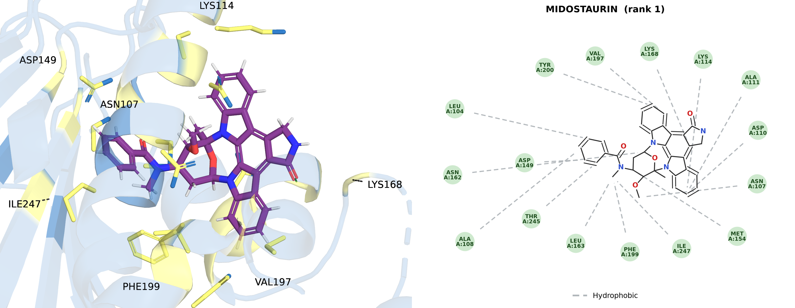
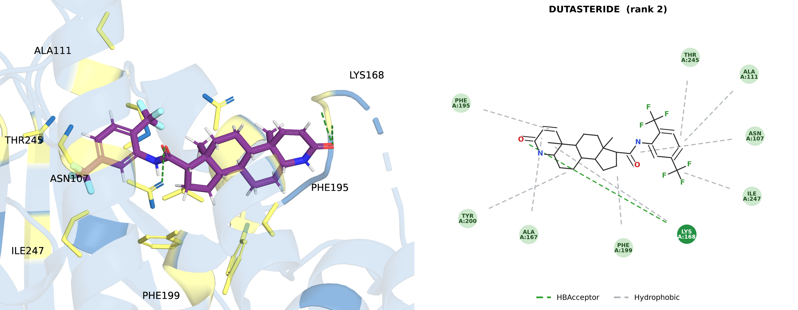
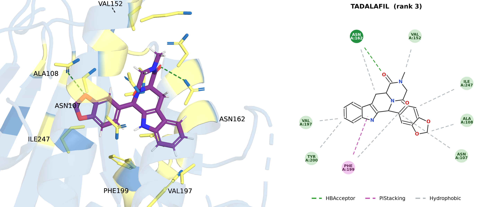
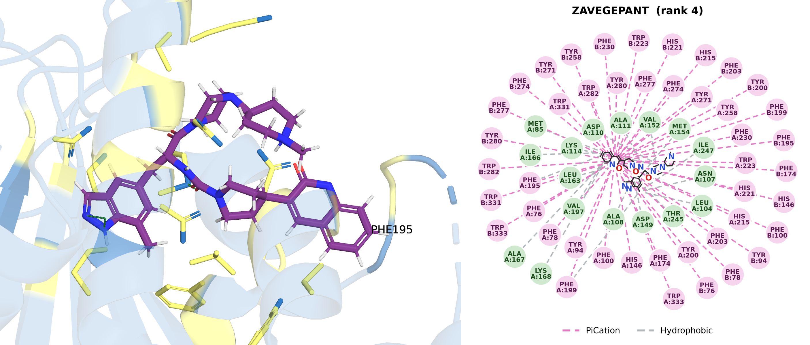
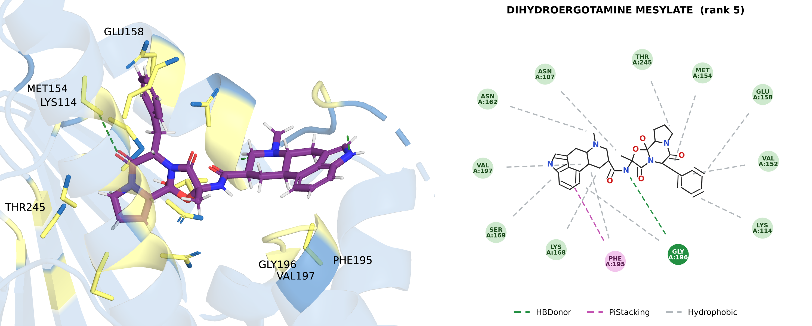
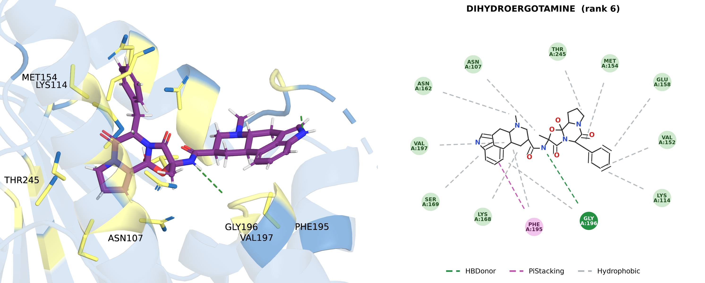
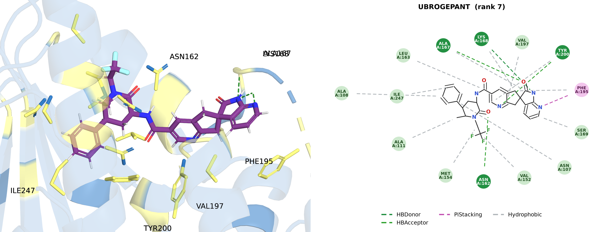
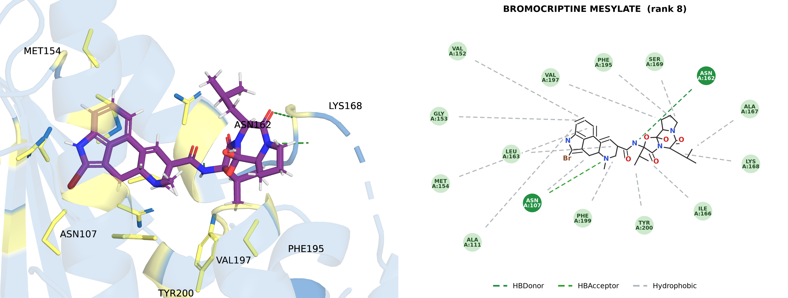
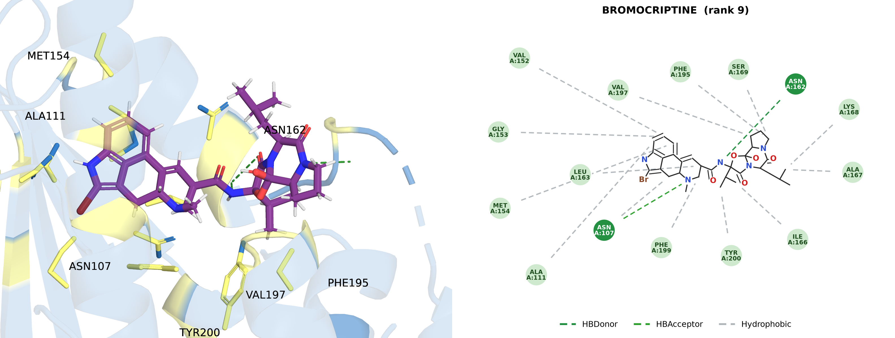
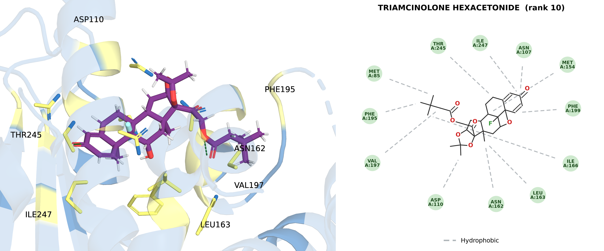

# AutoVS 虚拟筛选任务报告：HSP90B1（批次 full）

> 生成时间：2026-10-11 15:21 ｜ 框架：AutoVS（AutoDock Vina 批量虚拟筛选）

## 1. 任务概览

| 项目 | 值 |
|---|---|
| 靶点 | HSP90B1 |
| 结构 | PDB 7ULL（—）|
| 对接口袋 | 中心 (-7.1, 19.0, -5.0) Å，盒子 22, 22, 22 Å，co_crystal:reference_ligand_bound |
| 对接参数 | exhaustiveness=8, num_modes=9, seed=20261011 |
| 筛选库 | FDA 已上市药物（ChEMBL max_phase=4 本地化索引）|
| 质量门（共晶重对接）| **PASS**：打分窗口 1.0 kcal/mol 内最小 RMSD = **1.172 Å**（阈值 < 2.0 Å；top-1 pose RMSD 3.688 Å）|
| 命中阈值 | -7.0 kcal/mol |

## 2. 结果统计

- 实际对接：**2814** 个化合物
- 阈值命中（≤ -7.0 kcal/mol）：**1414** 个（50.2%）
- 最佳打分：**-10.8 kcal/mol**（MIDOSTAURIN，rank 1）

## 3. Top 20 排行

| rank | 化合物 | entry_id | 打分 (kcal/mol) | 中位打分 | MW | logP | 首次批准 |
|---:|---|---|---:|---:|---:|---:|---|
| 1 | MIDOSTAURIN | FDA01521_s1 | -10.8 | -10.22 | 570.65 | 5.91 | 2017 |
| 2 | DUTASTERIDE | FDA01978_s1 | -10.44 | -9.62 | 528.54 | 6.58 | 2001 |
| 3 | TADALAFIL | FDA00466_s1 | -10.26 | -8.21 | 389.41 | 2.21 | 2002 |
| 4 | ZAVEGEPANT | FDA02840_s1 | -10.15 | -9.0 | 638.82 | 3.45 | 2023 |
| 5 | DIHYDROERGOTAMINE MESYLATE | FDA01707_s1 | -10.14 | -9.18 | 679.8 | 1.59 | 1946 |
| 6 | DIHYDROERGOTAMINE | FDA01467_s1 | -10.1 | -9.24 | 583.69 | 2.08 | 1946 |
| 7 | UBROGEPANT | FDA02832_s1 | -10.07 | -8.75 | 549.55 | 3.53 | 2019 |
| 8 | BROMOCRIPTINE MESYLATE | FDA01701_s1 | -10.01 | -8.73 | 750.71 | 2.7 | 1978 |
| 9 | BROMOCRIPTINE | FDA00145_s1 | -10.0 | -8.1 | 654.61 | 3.19 | 1978 |
| 10 | TRIAMCINOLONE HEXACETONIDE | FDA01918_s1 | -9.96 | -7.46 | 532.65 | 4.41 | 1969 |
| 11 | FLUOCINONIDE | FDA01202_s1 | -9.95 | -7.7 | 494.53 | 2.94 | 1971 |
| 12 | AMCINONIDE | FDA01825_s1 | -9.91 | -8.47 | 502.58 | 3.52 | 1979 |
| 13 | NILOTINIB | FDA01237_s1 | -9.91 | -9.54 | 529.53 | 6.36 | 2007 |
| 14 | MIZOLASTINE | FDA00802_s1 | -9.9 | -8.82 | 432.5 | 3.41 | 1998 |
| 15 | FLUORESCEIN | FDA00744_s1 | -9.9 | -8.06 | 332.31 | 3.67 | 1976 |
| 16 | CICLESONIDE | FDA02547_s1 | -9.87 | -9.18 | 540.7 | 4.7 | 2006 |
| 17 | NILOTINIB HYDROCHLORIDE MONOHYDRATE | FDA02221_s1 | -9.87 | -9.32 | 584.0 | 5.95 | 2007 |
| 18 | TEMOPORFIN | FDA01350_s1 | -9.84 | -8.97 | 680.76 | 9.76 | 2001 |
| 19 | TEMAFLOXACIN HYDROCHLORIDE | FDA02722_s1 | -9.84 | -7.81 | 453.85 | 3.33 | 1992 |
| 20 | TEMAFLOXACIN | FDA00226_s1 | -9.78 | -7.78 | 417.39 | 2.9 | 1992 |

## 4. Top 命中结合模式（3D 口袋 | 2D 相互作用 对照图）

### rank 1 · MIDOSTAURIN（-10.8 kcal/mol）

**相互作用**：ASN107.A:Hydrophobic; MET154.A:Hydrophobic; LEU163.A:Hydrophobic; PHE199.A:Hydrophobic; ILE247.A:Hydrophobic; LEU104.A:Hydrophobic; ALA108.A:Hydrophobic; ASP149.A:Hydrophobic; THR245.A:Hydrophobic; ASN162.A:Hydrophobic; ASP110.A:Hydrophobic; ALA111.A:Hydrophobic; LYS114.A:Hydrophobic; LYS168.A:Hydrophobic; VAL197.A:Hydrophobic; TYR200.A:Hydrophobic

### rank 2 · DUTASTERIDE（-10.44 kcal/mol）

**相互作用**：LYS168.A:HBAcceptor; LYS168.A:Hydrophobic; PHE195.A:Hydrophobic; ALA167.A:Hydrophobic; TYR200.A:Hydrophobic; ASN107.A:Hydrophobic; ILE247.A:Hydrophobic; ALA111.A:Hydrophobic; THR245.A:Hydrophobic; PHE199.A:Hydrophobic

### rank 3 · TADALAFIL（-10.26 kcal/mol）

**相互作用**：ASN162.A:HBAcceptor; VAL152.A:Hydrophobic; ASN107.A:Hydrophobic; PHE199.A:Hydrophobic; ILE247.A:Hydrophobic; ALA108.A:Hydrophobic; VAL197.A:Hydrophobic; TYR200.A:Hydrophobic; ASN162.A:Hydrophobic; PHE199.A:PiStacking

### rank 4 · ZAVEGEPANT（-10.15 kcal/mol）

**相互作用**：LEU104.A:Hydrophobic; ASN107.A:Hydrophobic; PHE199.A:Hydrophobic; ILE247.A:Hydrophobic; MET154.A:Hydrophobic; ALA111.A:Hydrophobic; LEU163.A:Hydrophobic; PHE195.A:Hydrophobic; VAL197.A:Hydrophobic; MET85.A:Hydrophobic; ILE166.A:Hydrophobic; ALA167.A:Hydrophobic; LYS168.A:Hydrophobic; VAL152.A:Hydrophobic; ASP110.A:Hydrophobic; LYS114.A:Hydrophobic; ASP149.A:Hydrophobic; THR245.A:Hydrophobic; ALA108.A:Hydrophobic; PHE76.A:PiCation; PHE78.A:PiCation; TYR94.A:PiCation; PHE100.A:PiCation; HIS146.A:PiCation; PHE174.A:PiCation; PHE195.A:PiCation; PHE199.A:PiCation; TYR200.A:PiCation; PHE203.A:PiCation; HIS215.A:PiCation; HIS221.A:PiCation; TRP223.A:PiCation; PHE230.A:PiCation; TYR258.A:PiCation; TYR271.A:PiCation; PHE274.A:PiCation; PHE277.A:PiCation; TYR280.A:PiCation; TRP282.A:PiCation; TRP331.A:PiCation; TRP333.A:PiCation; PHE76.B:PiCation; PHE78.B:PiCation; TYR94.B:PiCation; PHE100.B:PiCation; HIS146.B:PiCation; PHE174.B:PiCation; PHE195.B:PiCation; PHE199.B:PiCation; TYR200.B:PiCation; PHE203.B:PiCation; HIS215.B:PiCation; HIS221.B:PiCation; TRP223.B:PiCation; PHE230.B:PiCation; TYR258.B:PiCation; TYR271.B:PiCation; PHE274.B:PiCation; PHE277.B:PiCation; TYR280.B:PiCation; TRP282.B:PiCation; TRP331.B:PiCation; TRP333.B:PiCation

### rank 5 · DIHYDROERGOTAMINE MESYLATE（-10.14 kcal/mol）

**相互作用**：GLY196.A:HBDonor; ASN162.A:Hydrophobic; ASN107.A:Hydrophobic; THR245.A:Hydrophobic; MET154.A:Hydrophobic; VAL152.A:Hydrophobic; LYS114.A:Hydrophobic; GLU158.A:Hydrophobic; LYS168.A:Hydrophobic; PHE195.A:Hydrophobic; VAL197.A:Hydrophobic; GLY196.A:Hydrophobic; SER169.A:Hydrophobic; PHE195.A:PiStacking

### rank 6 · DIHYDROERGOTAMINE（-10.1 kcal/mol）

**相互作用**：GLY196.A:HBDonor; ASN162.A:Hydrophobic; ASN107.A:Hydrophobic; THR245.A:Hydrophobic; MET154.A:Hydrophobic; LYS114.A:Hydrophobic; VAL152.A:Hydrophobic; GLU158.A:Hydrophobic; LYS168.A:Hydrophobic; PHE195.A:Hydrophobic; VAL197.A:Hydrophobic; GLY196.A:Hydrophobic; SER169.A:Hydrophobic; PHE195.A:PiStacking

### rank 7 · UBROGEPANT（-10.07 kcal/mol）

**相互作用**：LYS168.A:HBDonor; ASN162.A:HBAcceptor; ALA167.A:HBAcceptor; TYR200.A:HBAcceptor; ALA111.A:Hydrophobic; ASN107.A:Hydrophobic; ILE247.A:Hydrophobic; ALA108.A:Hydrophobic; LEU163.A:Hydrophobic; TYR200.A:Hydrophobic; VAL197.A:Hydrophobic; LYS168.A:Hydrophobic; PHE195.A:Hydrophobic; ALA167.A:Hydrophobic; SER169.A:Hydrophobic; MET154.A:Hydrophobic; VAL152.A:Hydrophobic; PHE195.A:PiStacking

### rank 8 · BROMOCRIPTINE MESYLATE（-10.01 kcal/mol）

**相互作用**：ASN162.A:HBDonor; ASN107.A:HBAcceptor; ALA167.A:Hydrophobic; LYS168.A:Hydrophobic; SER169.A:Hydrophobic; PHE195.A:Hydrophobic; VAL197.A:Hydrophobic; LEU163.A:Hydrophobic; MET154.A:Hydrophobic; VAL152.A:Hydrophobic; GLY153.A:Hydrophobic; ALA111.A:Hydrophobic; ASN107.A:Hydrophobic; PHE199.A:Hydrophobic; ILE166.A:Hydrophobic; TYR200.A:Hydrophobic

### rank 9 · BROMOCRIPTINE（-10.0 kcal/mol）

**相互作用**：ASN162.A:HBDonor; ASN107.A:HBAcceptor; ALA167.A:Hydrophobic; LYS168.A:Hydrophobic; SER169.A:Hydrophobic; PHE195.A:Hydrophobic; VAL197.A:Hydrophobic; LEU163.A:Hydrophobic; MET154.A:Hydrophobic; VAL152.A:Hydrophobic; GLY153.A:Hydrophobic; ALA111.A:Hydrophobic; ASN107.A:Hydrophobic; PHE199.A:Hydrophobic; ILE166.A:Hydrophobic; TYR200.A:Hydrophobic

### rank 10 · TRIAMCINOLONE HEXACETONIDE（-9.96 kcal/mol）

**相互作用**：ILE166.A:Hydrophobic; MET85.A:Hydrophobic; PHE195.A:Hydrophobic; VAL197.A:Hydrophobic; ASP110.A:Hydrophobic; MET154.A:Hydrophobic; THR245.A:Hydrophobic; ASN107.A:Hydrophobic; ILE247.A:Hydrophobic; PHE199.A:Hydrophobic; ASN162.A:Hydrophobic; LEU163.A:Hydrophobic

## 5. 方法与解读注意事项

- 打分来自 AutoDock Vina 半经验力场，仅用于富集排序；**绝对值不等于结合自由能**，命中需 MD/MMPBSA 或实验复核。
- Vina 对大环、多芳环、高柔性分子存在系统性打分偏好；Top 命中中该类骨架占比偏高时，建议按分子量/柔性分箱后再比较。
- 2D 相互作用为几何判据推断（氢键 H···A ≤2.6 Å 且 D-H···A >110°；疏水 C···C ≤4.0 Å；盐桥 ≤4.0 Å；π 堆积环心 ≤5.5 Å；阳离子-π ≤5.0 Å），供快速检视，不构成定量结论。
- 3D 图为正交投影口袋特写：天蓝半透明 cartoon、配体与口袋残基 stick、绿色虚线为氢键；标签经像素级标定，与残基一一对应。
- 完整排行榜见 `../../output_data/HSP90B1/{tag}_ranking.csv`；图谱索引见 `MANIFEST.csv`。
